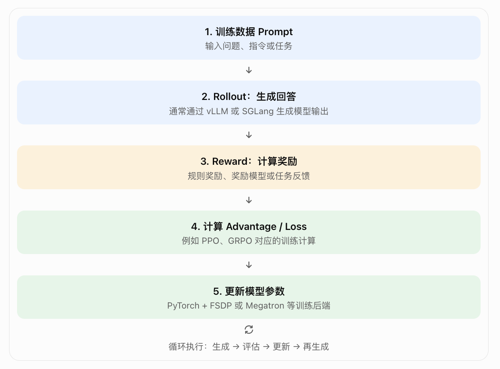
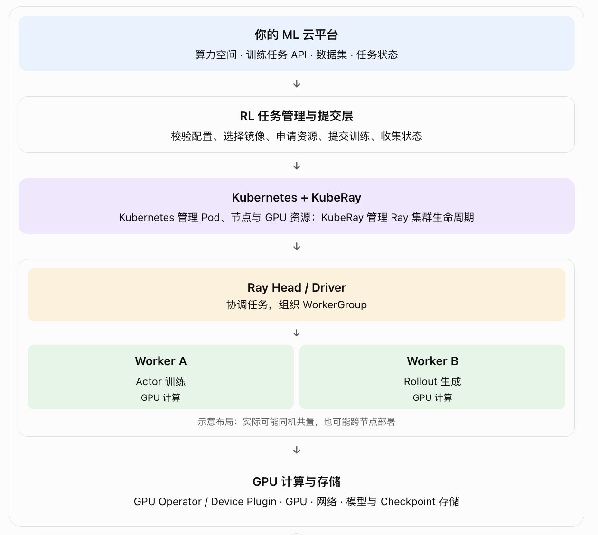

veRL 如何完成大模型强化学习训练，Ray 在其中做什么，以及怎样把它们集成进现有平台

项目repo：https://github.com/verl-project/verl
源码学习：https://palind-rome.github.io/verl-src-reading/

## veRL 是什么
veRL 是一个面向大语言模型强化学习的训练框架，项目名为 verl，其核心项目是 HybridFlow。

区分三个概念：
veRL：组织强化学习算法和训练流程，协调各类训练、生成、奖励计算组件。
Ray：负责分布式任务执行、Actor 生命周期、Worker 协调和资源放置等。
Kubernetes：负责 Pod、节点、GPU 等基础设施资源的编排；如果采用 KubeRay，还会负责 Ray 集群相关资源的生命周期。

它们不是相互替代的关系，而是不同层次的组件。
## 源码理解
不要一开始就从 PPO 数学实现或者整个仓库入口逐行看起。建议按照以下顺序：

| 顺序  | 重点              | 需要回答的问题                           |
| --- | --------------- | --------------------------------- |
| 1   | `examples/`     | 一个训练任务如何启动？                       |
| 2   | `verl/trainer/` | Trainer 如何组织训练循环？                 |
| 3   | `verl/workers/` | Actor、Rollout、训练 Worker 如何实现？     |
| 4   | Ray 相关实现        | 如何创建远程 Actor、分配资源和组织 WorkerGroup？ |
| 5   | 配置与后端           | 如何选择 GPU 数量、并行方式、模型和生成引擎？         |
源码目录会随版本演进，阅读时应以当前仓库实际结构为准。
## veRL 的整体架构

veRL 是面向大语言模型后训练的强化学习框架，其设计借鉴了 HybridFlow：结合集中式控制与分布式执行，把训练流程、模型计算和分布式资源组织起来。它可以组合 PyTorch FSDP、Megatron、vLLM、SGLang 等不同后端。

|组件|核心职责|类比|
|---|---|---|
|Trainer|决定训练流程：何时生成、计算奖励、更新模型|任务总指挥|
|Worker|执行具体的模型计算工作|工作进程|
|Rollout|用当前策略模型生成回答或轨迹|模型推理与采样环节|
|Ray|启动、调度和协调分布式执行单元|分布式执行基础设施|

注意：Rollout 是一种工作职责，不一定是独立进程或独立 Pod。 在 veRL 中，Actor 和 Rollout 可以部署在同一个混合 Worker 中，也可以根据配置分开。

-----

## veRL 学习路线

第一阶段：理解强化学习训练流程

基础

理解 Policy、Rollout、Reward、Advantage、PPO、GRPO。先知道训练为什么需要生成、评分和更新模型。

第二阶段：理解 veRL 架构

重点

学习 Trainer、Worker、WorkerGroup、Actor、Critic、Rollout、Reward Model，以及训练与推理如何协同。

第三阶段：理解 Ray 分布式执行

学习 Ray Actor、Placement Group、资源声明、跨节点调度、故障恢复，以及 Ray 与 Kubernetes 的边界。

第四阶段：源码与平台集成

研究 veRL 如何启动训练、创建 Worker、申请 GPU、加载模型、同步权重，并将其包装成平台的 RL 训练任务。
## 建议最终能够独立解释这几个问题：

1. 用户提交 RL 训练任务后，平台何时创建 Ray Cluster？
    
2. veRL 如何把一个训练任务拆分为不同的 Worker？
    
3. 单节点与多节点训练的执行路径有什么区别？
    
4. GPU 不足时，是 Kubernetes 无法调度 Pod，还是 Ray 无法满足资源放置要求？
    
5. 训练失败后，平台、KubeRay、Ray 和 veRL 各自负责什么恢复逻辑？
    
6. 训练完成后，如何保存模型、释放训练资源，并将模型交给已有推理服务？
    

按照你之前考虑的方案，可以先采用首次训练时创建 Ray 集群、后续训练复用、算力空间释放时销毁的思路进行架构评估，同时需要明确独占 GPU、并发任务和资源回收规则。

## 目标

你想先从哪条路线学习 veRL？

A. 架构入门：Trainer、Worker、Rollout、Ray 的关系

B. 源码入门：从训练示例跟踪到核心实现

C. 算法入门：PPO、GRPO 如何在 veRL 中实现

D. 实战入门：部署 veRL，跑通单节点和多节点训练

你的主要目标

集成到现有 Kubernetes ML 平台

理解 veRL 的整体设计与源码

自己动手运行和调试训练任务